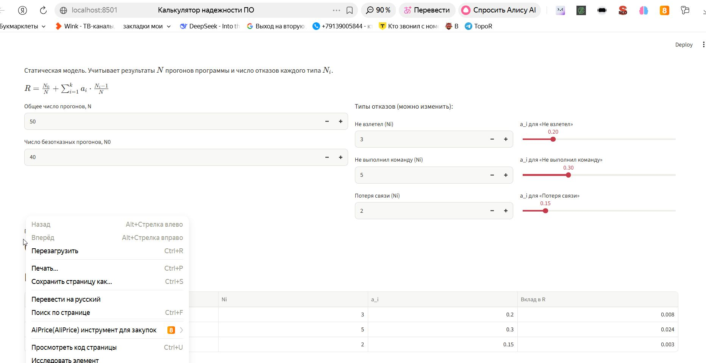
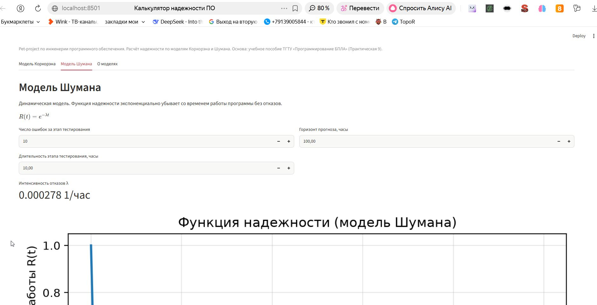

# Учебный проект: калькулятор надежности ПО

**Pet-project** по инженерии программного обеспечения. Веб-калькулятор для расчёта надежности программных средств по двум моделям: Коркорэна (статическая) и Шумана (динамическая).

## Стек
- Python 3.12
- Streamlit (веб-интерфейс)
- NumPy, Matplotlib (графики)
- SciPy

## Модели

### Модель Коркорэна
Статическая модель. Учитывает общее число прогонов $N$, число безотказных $N_0$ и число отказов каждого типа $N_i$ с вероятностью выявления $a_i$:

$$R = \frac{N_0}{N} + \sum_{i=1}^{k} a_i \cdot \frac{N_i - 1}{N}$$

### Модель Шумана
Динамическая модель. Функция надежности экспоненциально убывает со временем работы:

$$R(t) = e^{-\lambda t}$$

где $\lambda$ — наблюдаемая интенсивность отказов на этапе тестирования.

## Скриншоты

### Модель Коркорэна


### Модель Шумана


## Запуск
```bash
python3 -m venv venv
source venv/bin/activate
pip install -r requirements.txt
streamlit run app.py
